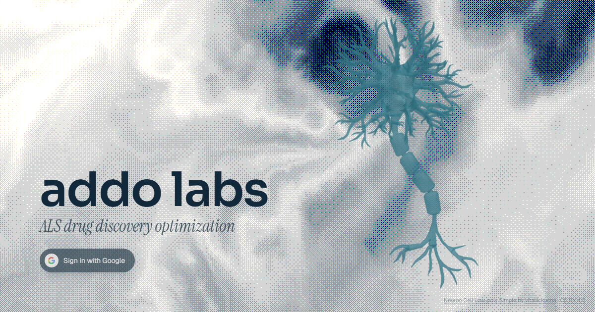

# Addo Labs

**Agentic drug repurposing for ALS, built for a blood–brain barrier that can now be opened.**

[Devpost](https://devpost.com/software/addo-labs-bv08ig) · [Live app](https://ai-ddo.study/) · [Demo video](https://www.youtube.com/watch?v=oRSRVEUyJmc)

Built at **BioHacks 2026** by Jeremy Siu, 3LFLightt, Neo Prohnitchi and Henri Yan.



---

## Why

The blood–brain barrier (BBB) blocks most drugs from reaching the brain. MR-guided
focused ultrasound (MRgFUS) can now open it temporarily in targeted regions, and
Sunnybrook was the first to use it to improve drug access in ALS. That reopens a
whole class of compounds that were written off because they couldn't cross the BBB.

Addo Labs is a research pipeline for clinicians and researchers that starts from one
patient's case and looks for those compounds.

## How it works

```
patient case ─► orchestrator ─► 5 research agents ─► DRKG matching ─► assessment ─► cited report
  (upload)      (Claude Opus)    (Claude Sonnet,      (TransE, 97k     (rank for this
                                  PubMed + NCBI)       entities)        patient + MRgFUS)
```

1. **Upload a patient case.** The case file is parsed into the features the agents need.
2. **Orchestrator agent** reads the patient record and writes a research plan: one brief
   per goal (slow progression, relieve a symptom, improve quality of life), unique to the
   patient.
3. **Research agents** run in parallel with PubMed and NCBI tools. Each returns *target
   profiles*, never drug names: the mechanism, molecular targets and desired action
   (`SOD1: reduce_expression`), and lessons from failed ALS trials.
4. **DRKG matching.** Each target becomes a TransE query in the
   [Drug Repurposing Knowledge Graph](https://github.com/gnn4dr/DRKG)'s 400-dimensional
   embedding space, and every DrugBank compound is ranked by L2 distance to it.
5. **Assessment and report.** The top drugs are researched individually, then ranked for
   this patient on mechanism, delivery fit with and without MRgFUS, safety, cost and
   availability. Every PubMed ID and trial number is checked to exist before it reaches
   the report. Clinicians can ask follow-up questions about the ranking in the same view.

A **take-home test** (facial expression, speech and line tracing) can be sent to a patient
through a one-time link. Results go back to the patient's case file so clinicians can see
what has changed between visits.

Nothing here is a diagnosis or a treatment recommendation.

## Built with

| Layer | Stack |
|---|---|
| Frontend | React 19, TypeScript, Vite, Tailwind v4, shadcn/ui, three.js (3D knowledge-graph view) |
| Agents | LangGraph on Claude (Opus orchestrates, Sonnet researches and assesses, Haiku per-drug research), LangSmith tracing |
| Backend | FastAPI with server-sent events, numpy, DRKG |
| Take-home test | PyTorch (POSTER++ facial expression model), Vosk offline speech recognition, OpenCV, browser tracing test |
| Infra | Vercel (frontend), Vultr + Caddy (backend), Supabase (auth, reports, test results) |

## Run it locally

### Frontend

Requires Node.js 20+.

```bash
npm install --prefix frontend
npm run dev --prefix frontend
```

Opens on <http://localhost:5173>. With no backend running, the pipeline plays a scripted
run against a sample patient (labelled **Simulated**), so the app always renders.

Sign-in and saved reports need Supabase: copy `frontend/.env.example` to `frontend/.env`
and fill it in. Every variable is documented there.

### Backend (live agents)

Requires Python 3.11+ and an Anthropic API key. From `backend/`:

```bash
python -m venv .venv
.venv/bin/pip install -r agent/requirements.txt -r diagnostics/requirements.txt  # Windows: .venv\Scripts\pip
cp agent/.env.example agent/.env      # fill in ANTHROPIC_API_KEY (and LANGSMITH_API_KEY if you trace)
.venv/bin/python -m agent.api         # serves on http://127.0.0.1:8001
```

With the API running, the frontend switches to the live pipeline (badge: **Live agent**).
DRKG data (217 MB) download steps are in `backend/agent/.env.example` under "Stage 3".
More detail: [`backend/agent/README.md`](backend/agent/README.md).

### Take-home test

The take-home test is served by the frontend at `/take-home/`. Facial and speech scoring
need the backend API plus model assets:

```bash
bash backend/diagnostics/facial-test/setup.sh       # POSTER++ checkpoint + face detector
bash backend/diagnostics/speech-test-good/setup.sh  # Vosk model
```

To run the full test as a standalone local app instead (opens on <http://127.0.0.1:8772>):

```bash
python backend/diagnostics/master-app/diagnostic_complete.py
```

After editing the test pages under `backend/diagnostics/`, run
`npm run sync:take-home --prefix frontend` to copy them into the frontend.

### Deploying

See [`docs/DEPLOY.md`](docs/DEPLOY.md) for the Vercel + Vultr setup.

## Repository layout

| Path | What it is |
|---|---|
| [`frontend/`](frontend/) | The Addo Labs web app, including the patient monitoring view |
| [`backend/agent/`](backend/agent/) | Orchestrator, research agents, DRKG matching, assessment, FastAPI server |
| [`backend/query-generation/`](backend/query-generation/) | Five fixed-category agents that turn a case into signed DRKG TransE queries |
| [`backend/diagnostics/`](backend/diagnostics/) | Take-home test: facial, speech and tracing tests, plus research scripts |
| [`backend/validation/`](backend/validation/) | Blinded top-five check comparing a ranking backend against a baseline |
| [`backend/contract/`](backend/contract/) | Schema, tests and validator for `backend/data/pipeline.json` |
| [`backend/data/`](backend/data/) | Pipeline contract sample and patient fixtures |
| [`docs/`](docs/) | Specs, research notes, decisions, deploy guide |

## Contributing

Read [`AGENTS.md`](AGENTS.md) first. It covers how work is claimed, branch naming and the
`pipeline.json` contract. Before pushing anything that touches the contract:

```bash
npm test --prefix backend/contract
```
